# neuro-practics

**Пять классических принципов обучения нейросетей — на одной задаче, с графиками и полным разбором.**

Этот репозиторий — учебный стенд. Здесь пять принципов, на которых держится всё машинное обучение, реализованы с нуля на NumPy/PyTorch и измерены друг напротив друга.

**Главное отличие от обычного набора лабораторных:** все пять практик решают **одну и ту же задачу на одном и том же датасете**. Поэтому сравнение в разделе 10 — это честный рейтинг, а не набор несопоставимых чисел.

**Задача: найти букву X.** Сеть получает картинку 28×28 с заглавной буквой и должна ответить — это X или нет.

---

## Содержание

1. [Сначала — что вообще такое нейросеть](#1-сначала--что-вообще-такое-нейросеть)
2. [Как запустить](#2-как-запустить)
3. [Что где лежит](#3-что-где-лежит)
4. [Датасет и задача](#4-датасет-и-задача)
5. [Пять принципов — коротко](#5-пять-принципов--коротко)
6. [Практика 1. Правило Хебба](#6-практика-1-правило-хебба)
7. [Практика 2. Дельта-правило](#7-практика-2-дельта-правило)
8. [Практика 3. Обратное распространение ошибки](#8-практика-3-обратное-распространение-ошибки)
9. [Практика 4. RBF-сети](#9-практика-4-rbf-сети)
10. [Практика 5. Карты Кохонена](#10-практика-5-карты-кохонена)
11. [Бенчмарк: все пятеро рядом](#11-бенчмарк-все-пятеро-рядом)
12. [Главные выводы](#12-главные-выводы)
13. [Глоссарий для тех, кто новичок](#13-глоссарий-для-тех-кто-новичок)
14. [Что можно улучшить дальше](#14-что-можно-улучшить-дальше)

---

## 1. Сначала — что вообще такое нейросеть

Если ты совсем с нуля, читай этот раздел. Если уже в теме — прыгай к [разделу 5](#5-пять-принципов--коротко).

### Нейрон — это калькулятор с ручкой настройки

Нейрон берёт несколько чисел на входе, выдаёт одно число на выходе. Между входом и выходом живут **веса** — числа, которые мы подбираем в процессе обучения.

```
входы x₁ x₂ x₃
    │  │  │        (умножаем каждый на свой вес)
    ▼  ▼  ▼
  [ w₁ ][ w₂ ][ w₃ ]  →  Σ  →  [активация]  →  выход y
                       +bias
```

Конкретный пример. Ты хочешь предсказать, болен ли пациент, по трём анализам. Нейрон:

```
y = sigmoid(w₁·x₁ + w₂·x₂ + w₃·x₃ + b)
```

где `sigmoid(z) = 1/(1+e⁻ᶻ)` — функция, которая сжимает любое число в диапазон 0…1 («вероятность болезни»).

**Веса `w₁, w₂, w₃` и `b` — это то, чему мы учимся.** В начале они случайные (сеть ничего не знает). После обучения — подобраны так, чтобы сеть отвечала правильно.

### Что значит «обучение»

Обучение — это **подбор весов**, при котором сеть ошибается всё меньше.

1. Подаём пример на вход.
2. Смотрим, что сеть ответила.
3. Считаем **ошибку** (насколько ответ отличается от правильного).
4. **Подкручиваем веса** в ту сторону, которая ошибку уменьшит.
5. Повторяем миллион раз.

Разные принципы обучения отличаются **только пунктом 4** — как именно крутить веса. Всё остальное одинаково.

### Что такое «принцип обучения»

Пять классических способов выполнить пункт 4:

| Принцип | Кто придумал | Суть в одну строку | Учитель нужен? |
|---|---|---|---|
| Правило Хебба | Дональд Хебб, 1949 | Нейроны, которые сработали вместе, связываются сильнее | Нет |
| Дельта-правило | Уидроу-Хофф, 1960 | Ошибка говорит, какие веса поднять, а какие опустить | Да |
| Backprop | Румельхарт-Хинтон-Уильямс, 1986 | Ошибка с выхода растекается по слоям назад | Да |
| RBF | Брумхед-Лоу, 1988 | «Колокола» на данных + линейный слой поверх | Да |
| SOM | Тээво Кохонен, 1982 | Сеть сама разложила данные по карте | Нет |

### Три кита, на которых стоит всё

- **Принцип обучения** — как подбирать веса (это и есть предмет пяти практик).
- **Архитектура** — как нейроны соединены между собой (один слой, два слоя, решётка...).
- **Данные** — на чём сеть учится.

### Ориентиры: две шкалы, которые надо различать

**Train accuracy** — насколько сеть хорошо отвечает на то, что видела при обучении.
**Test accuracy** — насколько хорошо отвечает на то, чего **не видела**.

Если train высокий, а test низкий — сеть **переобучилась**: выучила конкретные примеры, а не общий закон.

---

## 2. Как запустить

Нужен Python 3.11+ (проверено на 3.12) и `uv`.

```bash
cd ~/Hermes/neuro_practics

# Создать виртуальное окружение
uv venv .venv
source .venv/bin/activate

# Поставить зависимости
uv pip install numpy scikit-learn matplotlib pandas pillow
uv pip install torch --index-url https://download.pytorch.org/whl/cpu

# Запустить ОДНУ практику
python -m practice_1_hebb.demo

# Или запустить ВЕСЬ бенчмарк разом
python -m comparison.benchmark
```

Всё, что рисуется, сохраняется в `outputs/` (картинки PNG + `benchmark.csv`).
Копия тех же картинок лежит в `docs/images/` — она закоммичена в репозиторий, поэтому
можно смотреть графики прямо на GitHub, не запуская ничего.

> Ничего скачивать не нужно: датасет букв рисуется локально шрифтами системы
> через PIL. Первый запуск занимает ~2 секунды, дальше датасет кэшируется.

---

## 3. Что где лежит

```
neuro_practics/
├── README.md                 ← ты здесь
├── pyproject.toml            ← зависимости
├── .gitignore
│
├── common/
│   ├── letters.py            ← общий датасет букв + шум/окклюзия
│   ├── datasets.py           ← общие загрузчики: Iris, two-moons, XOR
│   └── metrics.py            ← метрики бинарной задачи «найти X»
│
├── practice_1_hebb/
│   ├── hebb.py               ← класс HebbianClassifier
│   ├── demo.py               ← эксперименты + графики
│   └── README.md
│
├── practice_2_delta/
│   ├── perceptron.py         ← класс Perceptron
│   ├── demo.py
│   └── README.md
│
├── practice_3_backprop/
│   ├── mlp.py                ← класс MLP + загрузка букв в torch
│   ├── demo.py               ← + аугментации
│   └── README.md
│
├── practice_4_rbf/
│   ├── rbf.py                ← класс RBFNet
│   ├── demo.py
│   └── README.md
│
├── practice_5_som/
│   ├── som.py                ← класс SOM
│   ├── demo.py
│   └── README.md
│
├── comparison/
│   ├── benchmark.py          ← прогоняет все пять, рисует сравнение
│   └── README.md
│
├── docs/images/              ← закоммиченные графики (для README)
└── outputs/                  ← свежие артефакты (в .gitignore)
```

---

## 4. Датасет и задача

Один датасет на всех — `common/letters.py`.

### Как устроены картинки

Заглавные буквы **A–Z** рисуются через PIL системными шрифтами на холсте 28×28 и
переводятся в бинарные векторы (чернила = 1, фон = 0).

| | шрифты | картинок |
|---|---|---|
| **train** | Carlito (Regular / Bold / Italic / Bold-Italic) + Liberation Sans (4 стиля) | 26 × 8 × 12 = **2 496** |
| **test** | Liberation Serif (3 стиля) + FreeSans (3 стиля) | 26 × 6 × 4 = **624** |

**Тестовые шрифты — из других семейств, которых сеть не видела в обучении.** Это
сделано намеренно: цифра в таблице показывает не запоминание, а обобщение на новый
стиль письма. Иначе 26 картинок на класс хватило бы, чтобы выучить их наизусть.

Каждая картинка немного отличается от «эталонной»: случайный сдвиг ±2 px, поворот
±8°, масштабирование глифа. Так что сеть видит не 26 картинок, а 2 496.

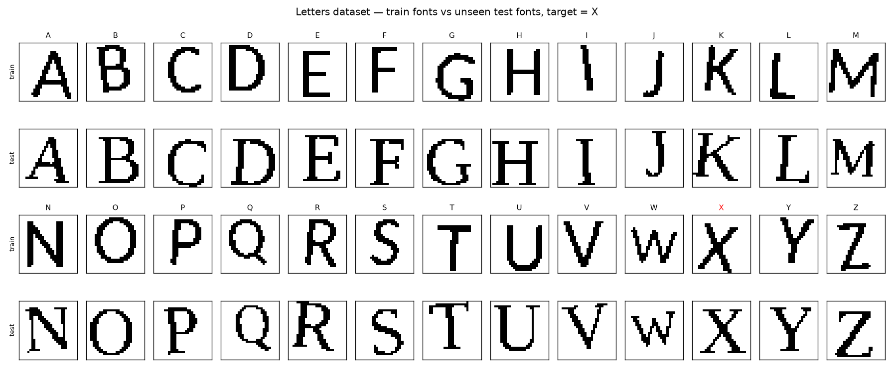

### Задача: найти букву X

Из 26 классов выбираем один — **X**. Нужно ответить на бинарный вопрос: «эта
картинка — X или нет?»

### Почему метрика — balanced accuracy

X — это 1 класс из 26, то есть 3.8% всех картинок. Сеть, которая **всегда** говорит
«не X», получает 96% обычной accuracy и при этом не сделала ничего полезного.

Поэтому главная метрика — **balanced accuracy**: среднее из двух величин.

```
balanced accuracy = ½ · (recall на X + specificity)
```

- **recall** — из всех X'ов сколько сеть нашла;
- **specificity** — из всех остальных букв сколько она не приняла за X.

Эта метрика честна для всех пяти практик, поэтому цифры в бенчмарке сравнимы
между собой. Дополнительно считаем ROC-AUC (насколько хорошо сеть **ранжирует**
картинки по вероятности «это X») и точность по всем 26 классам.

---

## 5. Пять принципов — коротко

| # | Принцип | Нейронов | Параметров | Учитель | Score (balanced acc) |
|---|---|---|---|---|---|
| 1 | Хебб | 26 | 20 384 | нет | 0.893 |
| 2 | Дельта | 1 | 785 | да | 0.903 |
| 3 | Backprop | 26 | 120 346 | да | **0.978** |
| 4 | RBF | 120 | 3 146 | да | 0.957 |
| 5 | SOM | 256 | 200 704 | нет | 0.853 |

Теперь эти пять чисел **можно сравнивать** — они измерены на одном датасете, по
одному протоколу, по одной метрике.

---

## 6. Практика 1. Правило Хебба

**Задача:** сеть сама собирает образец каждой буквы и по нему узнаёт X.

### Идея, как для дурака

> «Клетки, которые активируются вместе, связываются вместе». © Дональд Хебб, 1949

Представь компанию из людей. Если Аня и Боря постоянно вместе (часто появляются одновременно), связь между ними крепнет. Если Аня всегда с Вовой, а Вова с Борей — все трое сплетутся в один кружок.

Нейрон работает так же. Есть входы `x` (картинка) и выходы `y` (другие нейроны). Если вход `i` и выход `j` активны одновременно — усиливаем связь `w[i][j]`.

### Формула

```plaintext
ΔW[c] = η · x
```

Выходной нейрон `c` «зажат» на правильном классе — он сработал вместе с картинкой,
значит связь между ними крепнет.

### Что в итоге получается

После обучения каждая строка `W` — это **средняя картинка своего класса**. Сеть
сама, без градиентов, собрала 26 образцов. Вот они:

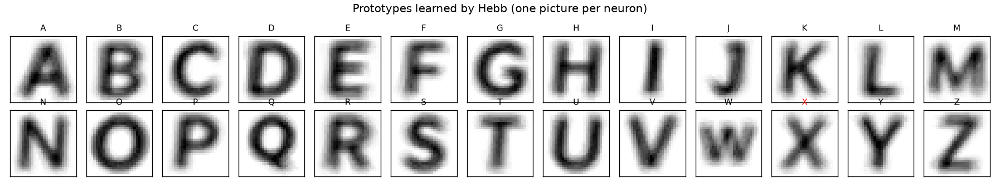

Читается через косинусное сходство:

```plaintext
s_c(x)   = cos(W[c], x)
P(class) = softmax_c(s_c(x) / T)
```

### Про Ойю — её тут нет

Классический Хебб **без ограничения** веса растут бесконечно. Раньше в этой
практике для этого использовалось правило Ойи:

```plaintext
ΔW = η · (x · xᵀ − W · x²)      ← Oja, её убрали
```

Второе слагаемое — штраф за слишком большие веса. **Мы его убрали.** Вместо этого
нормируем на этапе *чтения*: решение принимается по косинусному сходству, а правило
обучения остаётся чистым учебниковым Хеббом. Результат тот же, а правило — одно,
без «модификаций».

### Кривые

**Learning curve плоская** — и это честно: Хебб усредняет картинки, поэтому второй
эпох не добавляет ничего, кроме множителя масштаба:

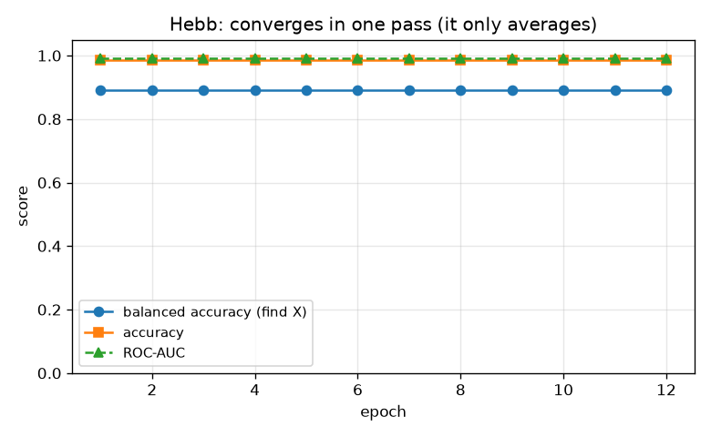

Зато кривая **по объёму данных** растёт всё время — больше картинок на класс
значит более чёткий прототип:

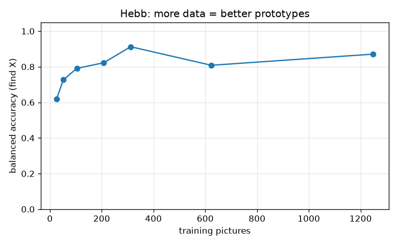

### Детектор X

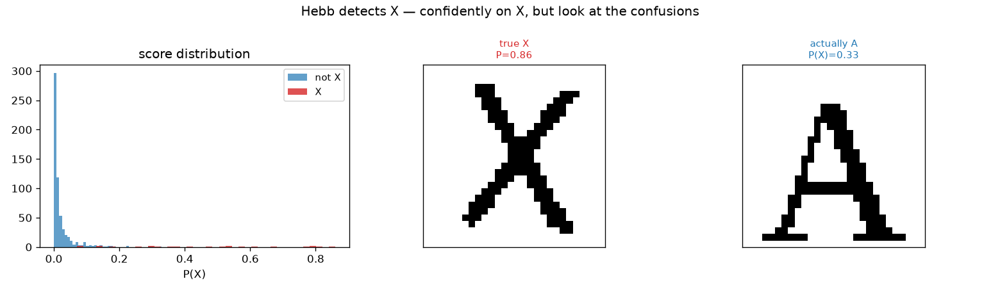

### Устойчивость к повреждениям

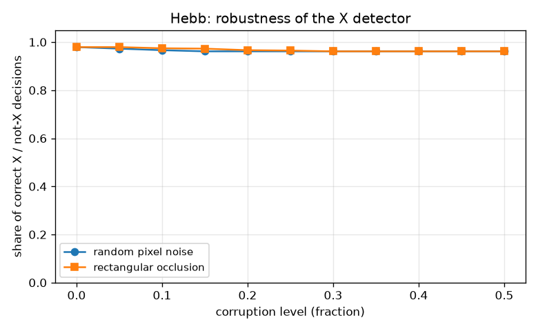

### Выводы

- Хебб учит **прототипы, а не признаки** — это видно на картинке прототипов.
- **Одна эпоха достаточна.** Кривая обучения плоская — это свойство правила, а не
  баг.
- **Данных важнее, чем эпох.** Кривая по размеру выборки растёт долго после того,
  как кривая обучения уже выровнялась.
- Без нормализации на чтении чистый Хебб для классификации непригоден, но
  нормализация при принятии решения решает проблему, не трогая правило обучения.
- **На 26 классах Хебб проигрывает** backprop (0.713 против 0.912) — прототип на
  класс не выражает «X — это диагональный крест» так же хорошо, как обученная сеть.

---

## 7. Практика 2. Дельта-правило

**Задача:** один-единственный нейрон должен найти X среди остальных букв.

### Идея, как для дурака

> Учитель говорит: «Ты написал 5, а надо было 7. Значит те веса, которые помогли тебе написать 5, надо чуть-чуть поднять. А те, что утянули вниз, — опустить.»

Это Хебб, но с **учителем** и с **направлением**: не просто «связались», а «связались в правильную сторону».

### Формулы

```plaintext
y      = σ(W·x + b)                 выход сети
e      = t − y                      ошибка (t — правильный ответ)
ΔW     = η · e · σ'(net) · x        подправить веса
Δb     = η · e · σ'(net)
```

`σ'(z) = σ(z)·(1−σ(z))` — производная сигмоиды, появляется из цепного правила.

### Задача 7.1: XOR — почему один нейрон недостаточен

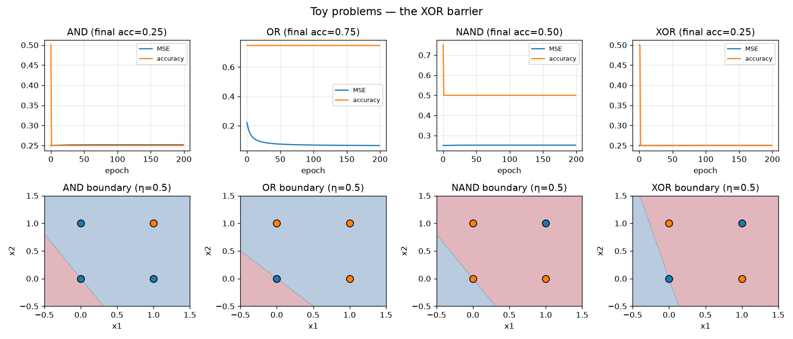

Верхний ряд — кривые обучения, нижний — границы решений.

- **AND, OR, NAND** — сходятся за десятки эпох, граница ровная.
- **XOR** — **не сходится никогда**. Кривая уезжает вверх, граница остаётся неверной.

Почему? Точки XOR невозможно разделить одной прямой. Нейрон рисует ровно одну границу (даже если изогнутую — это всё равно одна гиперплоскость). Нужен минимум **два** нейрона во втором слое. Это ограничение породило многослойные сети и, в конечном счёте, deep learning.

### Задача 7.2: один нейрон охотится за X

784 входа, один нейрон, 785 параметров:

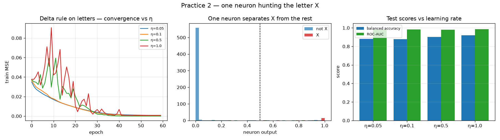

Слева — сходимость при разных η. По центру — распределение выходов нейрона для X
и для остальных букв. Справа — итоговые метрики.

Результат: **balanced accuracy 0.903**, ROC-AUC 0.981.

### Что нейрон выучил

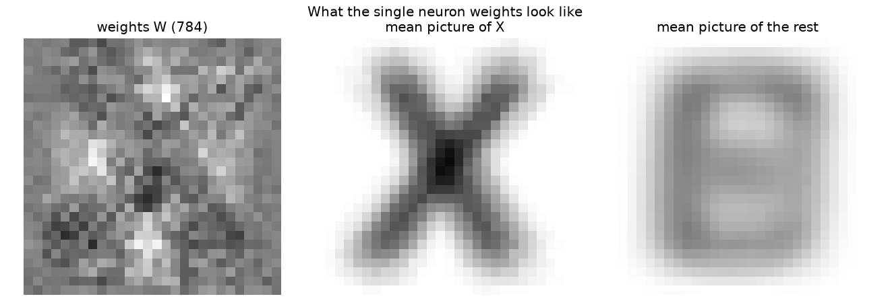

### Выводы

- **Один нейрон, 784 входа, одна задача** — и он работает: 0.903 при 785
  параметрах против 0.978 у MLP со 120 000.
- Линейная разделимость — жёсткий потолок одного нейрона. XOR это доказывает. На
  буквах работает потому, что «X» — это в основном линейное свойство пикселей.
- **Хромает precision**: recall 0.833, но precision 0.556 — нейрон находит почти
  все X'ы, но и загорается на кучу букв, которые не следовало бы (V, W и Y — тоже
  диагонали). Прямая линия не отличит диагональный крест от диагональной черты.
- η критичен: слишком мал → медленно, слишком больш → колебания.
- Инициализация весов влияет сильнее, чем кажется.

---

## 8. Практика 3. Обратное распространение ошибки

**Задача:** распознать букву (26 классов), а по softmax-нейрону X — найти саму X.

### Идея, как для дурака

Представь цепочку испорченного телефона:

```
Картинка → [слой 1] → [слой 2] → Ответ
```

Ошибка в ответе — «последний человек в цепочке напортачил». Чтобы понять, кто виноват, надо **пройти цепочку назад**: последний слой делит свою ошибку между своими входами, каждый вход — между своими входами, и так до самого начала. Каждый слой получает свою долю вины и подкручивает свои веса.

Это и есть **chain rule (цепное правило)**, применённое к сети.

### Формулы

```plaintext
Прямой проход:   a₁ = ReLU(W₁x + b₁)
                 a₂ = ReLU(W₂a₁ + b₂)
                 y  = softmax(W₃a₂ + b₃)
Потери:          L  = CrossEntropyLoss(y, t)
Обратный проход: ∂L/∂W₃ = (ŷ − t)·a₂ᵀ
                 ∂L/∂W₂ = (∂L/∂a₂)·W₃ᵀ·ReLU′(z₁)·a₁ᵀ
                 ∂L/∂W₁ = (∂L/∂a₁)·W₂ᵀ·ReLU′(z₂)·xᵀ
```

В PyTorch всё это автоматизировано: `loss.backward()` считает все градиенты, `optimizer.step()` обновляет веса.

### Пять экспериментов

**8.1. Размер скрытого слоя** (25 эпох):

| hidden | параметры | test acc (26 кл.) | balanced acc (X) |
|---|---|---|---|
| 32 | 27 034 | 0.904 | 0.997 |
| 64 | 56 090 | 0.913 | 0.938 |
| 128 | 120 346 | 0.912 | 0.978 |
| 256 | 273 434 | 0.923 | 0.978 |

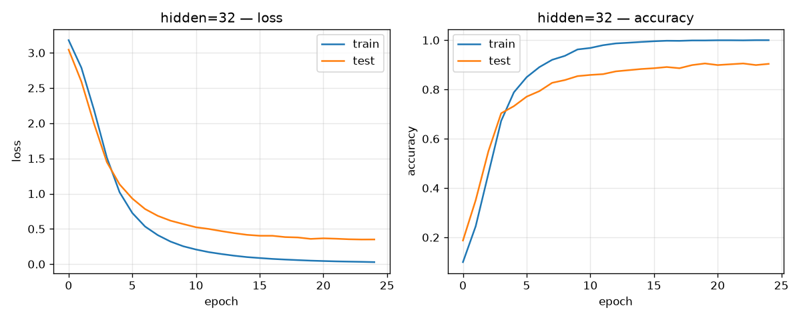
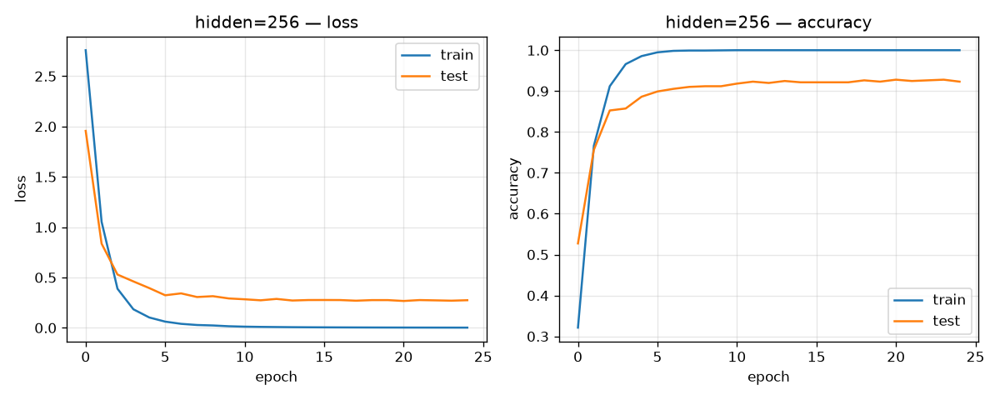

Ширина даёт точность дёшево (+2 пункта за 10× параметров), но предельный выхл быстро падает.

**8.2. Активация** — ReLU против Tanh:

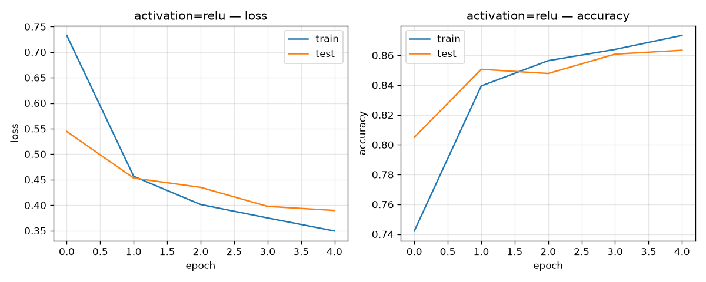
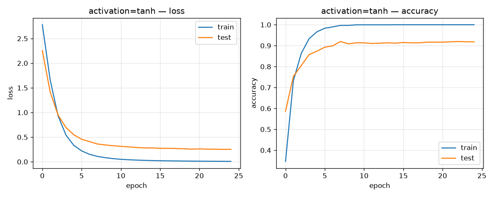

**8.3. Оптимизатор** — SGD против Adam:

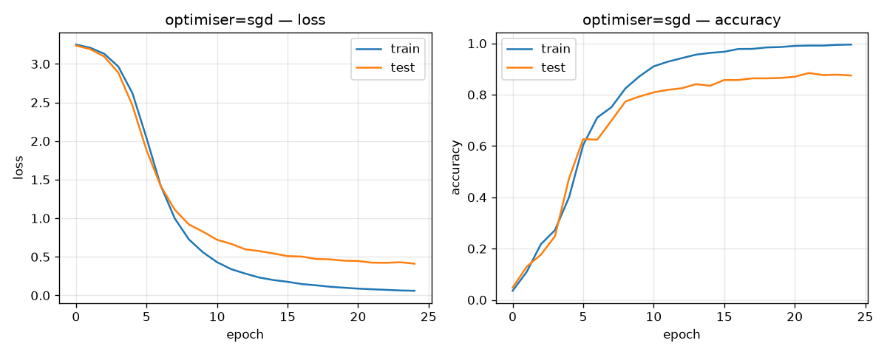


**8.4. Dropout** (случайно выкидываем 25% или 50% нейронов на каждом шаге):

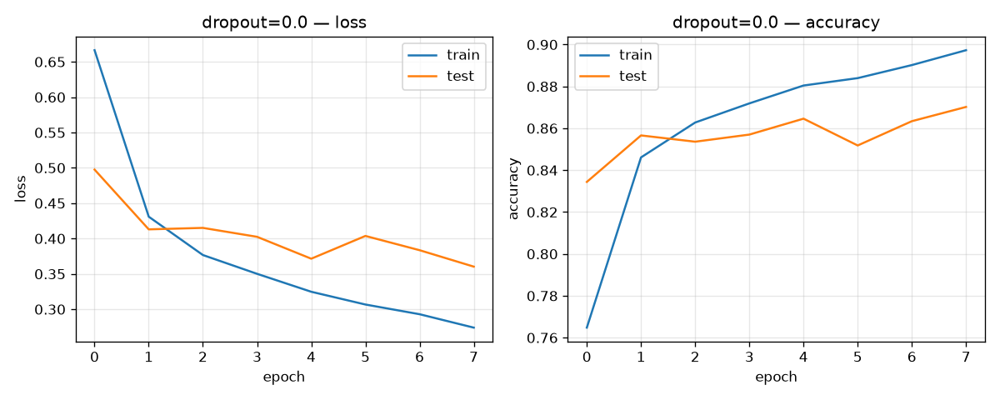
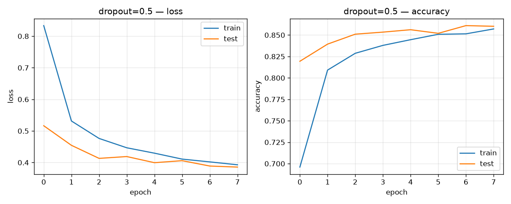

**8.5. Аугментация данных** — сдвиг ±2 px + поворот ±10° на лету, каждый батч:

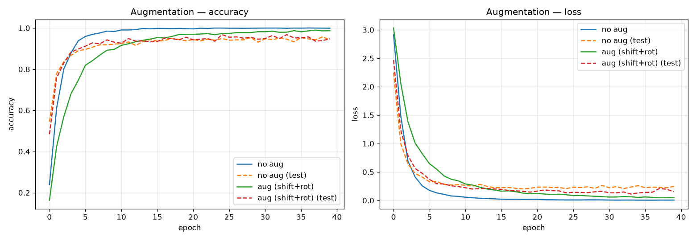

| вариант | test acc (26 кл.) | balanced acc (X) |
|---|---|---|
| без аугментации | 0.942 | 0.996 |
| сдвиг + поворот | **0.947** | 0.978 |

Прочитайте таблицу внимательно: аугментация **чуть подняла** точность по всем 26
классам, но **снизила** уверенность в детекторе X. Это не противоречие: поворот
учит сеть, что X, повёрнутый на 30°, — это уже не X, поэтому она осторожнее с
похожими на X диагональными буквами.

### Детектор X

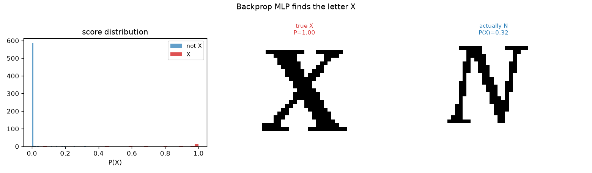

### Выводы

- Backprop — лидер качества: **0.978** balanced accuracy, 0.912 по всем 26 классам,
  на шрифтах, которых сеть не видела.
- Оптимизатор здесь важнее архитектуры: Adam обгоняет SGD на ~4 пункта.
- Dropout и аугментация — два разных инструмента против одного и того же
  (переобучения), и работают они лучше вместе.

---

## 9. Практика 4. RBF-сети

**Задача:** классифицировать буквы (26 классов) через «колокола» на данных.

### Идея, как для дурака

Представь комиссию из экспертов-«колоколов». Каждый эксперт отвечает за свою область: один — за «нули», другой — за «единицы», третий — за «двойки».

Колокол — это функция `φ(x) = exp(−‖x − c‖² / 2σ²)`:
- Если `x` **рядом** с центром колокола `c` → значение близко к 1 («эксперт уверен»).
- Если `x` **далеко** → значение близко к 0 («эксперт молчит»).

На выходе — обычная **линейная комбинация** голосов экспертов. Вот и вся сеть.

Центры колоколов выбираются автоматически — **K-means** (кластеризация). Ширина — медианное расстояние до соседних точек.

### Ключевая особенность: два этапа обучения

| Этап | Что обучается | Сколько стоит |
|---|---|---|
| 1. K-means | центры `c` и ширины `σ` | один раз, дёшево, без градиентов |
| 2. Линейный слой | веса `W` | **закрытая формула** (метод наименьших квадратов) |

Второй этап решается **одним** `np.linalg.lstsq` — никаких эпох, никакой скорости обучения. Сравните с backprop, где каждый вес обновляется на каждом шаге каждой эпохи.

**Одна сеть вместо 26.** Выходной слой умеет обучаться сразу на несколько
классов: передаёшь `y` матрицей `(n, 26)` — получаешь 26 линейных считывателей
с общим скрытым слоем. Один K-means вместо 26 — и быстрее, и точнее.

### Результаты

**Приближение функции** `sin(2x)` — разрешение сети растёт с числом центров:

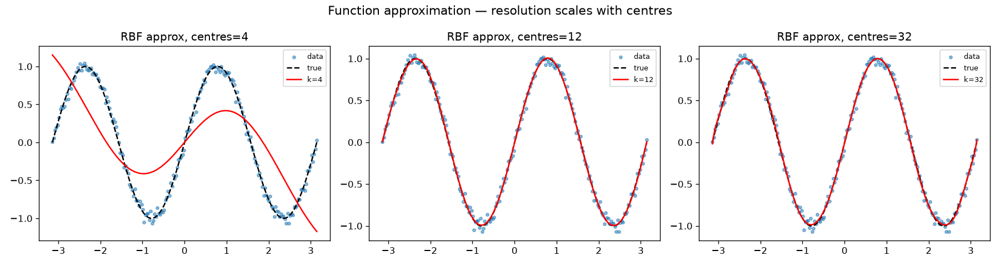

**Классификация букв**:

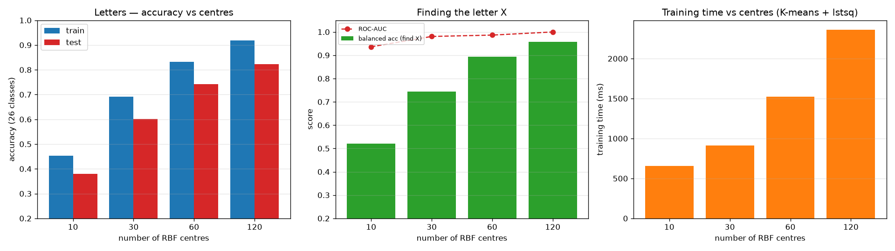

| центров | train acc | test acc (26 кл.) | balanced acc (X) | AUC | время |
|---|---|---|---|---|---|
| 10 | 0.454 | 0.380 | 0.520 | 0.936 | 0.64 с |
| 30 | 0.692 | 0.601 | 0.744 | 0.981 | 0.99 с |
| 60 | 0.833 | 0.742 | 0.893 | 0.986 | 1.37 с |
| 120 | 0.919 | 0.824 | **0.957** | **1.000** | 2.26 с |

**Центры, которые срабатывают на X:**

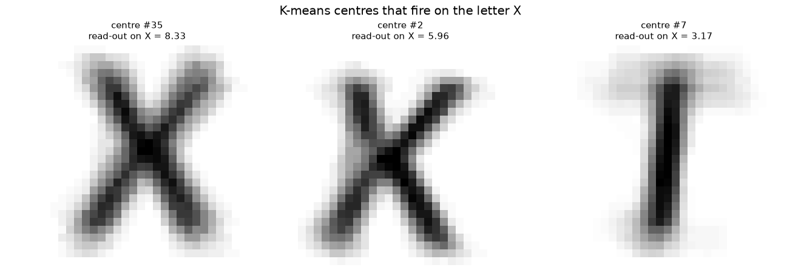

**Граница решения на two-moons** с наложенными центрами K-means:

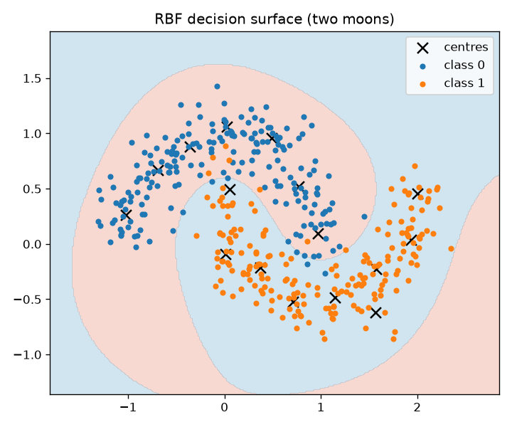

### Выводы

- **3 146 параметров против 120 000 у MLP** — и RBF выигрывает по AUC (1.000) и
  почти догоняет по balanced accuracy (0.957 против 0.978). Правило «бери самое
  простое, что работает» подтверждено.
- Закрытая форма для выходного слоя — это не «трюк», а принципиальное
  преимущество: нет итераций, нет learning rate, нет затухания.
- Общий скрытый слой вместо 26 one-vs-rest сетей: **в 50 раз быстрее** и точнее.
- RBF хорош на небольших гладких задачах. На сырых пикселях растущих картинок
  (Fashion-MNIST) он проигрывает CNN — ему нужен ручной признаковый слой.

---

## 10. Практика 5. Карты Кохонена

**Задача:** разложить буквы по двумерной карте так, чтобы похожие буквы оказались
рядом, а потом по этой карте отвечать на вопрос «это X?»

### Идея, как для дурака

Представь карту метро. Станции расположены так, что соседние станции находятся рядом в географии. Ты строишь такую карту из точек, у которых есть координаты в каком-нибудь пространстве, но ты заранее не знаешь как эти точки «разложить по сетке».

Алгоритм:
1. На каждую точку смотрим — **какой нейрон (станция) ближе всего**? Это победитель (BMU, best matching unit).
2. Победитель и его **соседи по сетке** подтягиваются к точке.
3. Повторяем много раз. Победитель перемещается, за ним переползают соседи.

Ключевое: **кто именно победил каждый раз — никто не знает заранее**. Сеть сама
находит структуру.

Дополнительно: и скорость обучения `η`, и радиус соседства `σ` **уменьшаются** со
временем. Сначала перемещается вся карта (глобальная структура), потом — только
локальные подстройки.

### Как из unsupervised получается ответ про X

SOM обучается **без меток**. Метки подставляют **после** обучения: каждый нейрон
получает самый частый класс из картинок, которые он выиграл. Дальше:

- `classify(x)` — класс нейрона-победителя;
- `target_score(x)` — мягкая оценка: какая доля из 5 ближайших нейронов (с
  гауссовыми весами по расстоянию) относится к классу X.

### U-матрица

Главная диагностика SOM — **U-матрица**: для каждого нейрона считается среднее расстояние до его четырёх соседей по сетке и рисуется heatmap.

- Тёмные области — нейроны рядом друг с другом, значит там одно кластер.
- Светлые полосы — **границы кластеров**.

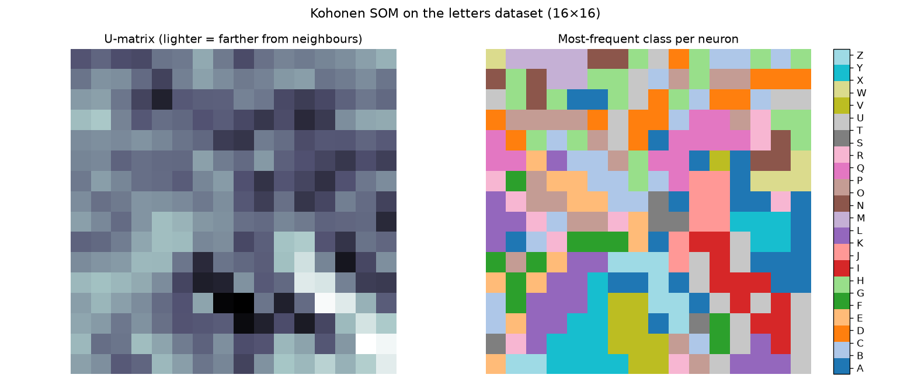

### Карта классов

Каждому нейрону присваивается самый частый класс среди точек, которые он выиграл. Если топология сохранилась, каждая клеточка «однородна» — это правая панель на рисунке выше.

### Размер карты

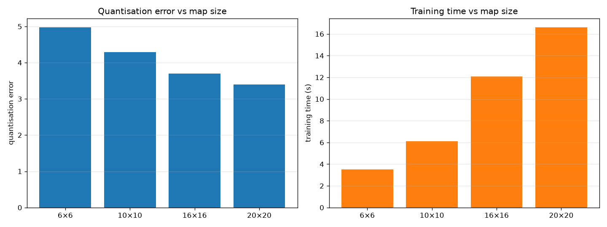

| карта | нейронов | quant. error | test acc (26 кл.) | balanced acc (X) | время |
|---|---|---|---|---|---|
| 6×6 | 36 | 8.848 | 0.333 | 0.682 | 2.6 с |
| 10×10 | 100 | 8.093 | 0.489 | 0.890 | 3.3 с |
| 16×16 | 256 | 7.302 | 0.646 | 0.853 | 5.6 с |
| 20×20 | 400 | 6.906 | 0.673 | 0.833 | 8.8 с |

**Карта должна быть больше, чем классов.** 26 букв в карте 6×6 (36 нейронов) —
это примерно один нейрон на букву, карта не может разложить похожие буквы рядом,
и точность падает до 0.333.

### Где на карте живёт X

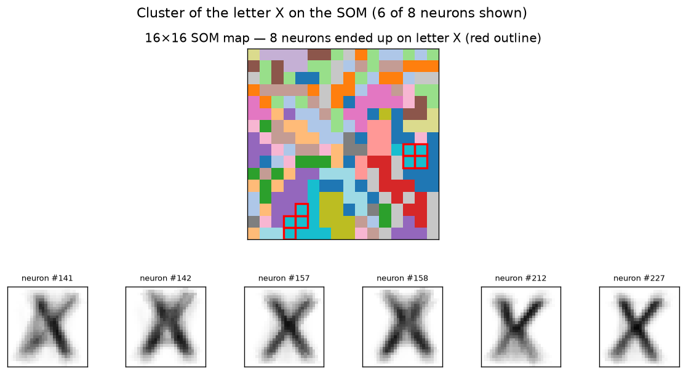

### Сравнение с PCA

Тот же датасет, но спроецированный линейным методом — для контраста:

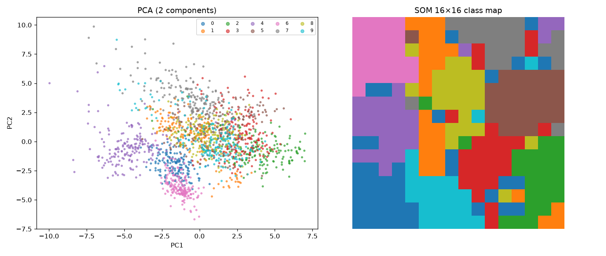

PCA раскладывает данные на плоскость «через центр масс», и классы в ней **размазаны**. SOM строит **топологическую** карту, где границы кластеров становятся частью самой карты — по ней можно ездить как по метро.

### Выводы

- SOM работает **без учителя** — метки нужны только для того, чтобы проверить,
  насколько хорошо сохранилась структура.
- Размер карты — это размер «словаря» кластеров: слишком тесно, и структура не
  помещается.
- Большая карта даёт меньшую ошибку, но выгода быстро вырождается: 20×20 всего на
  5% лучше 16×16 при 1.6× времени.
- Топологическая близость — **мягкое** ограничение. Если соседние нейроны не
  представляют похожие входы, SOM не справился.
- Обучение идёт в batch-режиме (эпоха за эпохой, суммарный вклад вместо
  поштучного) — это та же формула, просто считается через BLAS. На 784-мерных
  картинках это разница между 5 секундами и 4 минутами.

---

## 11. Бенчмарк: все пятеро рядом

Запуск: `python -m comparison.benchmark`

| practice | params | neurons | train time | balanced acc | AUC | recall(X) | 26-class acc |
|---|---|---|---|---|---|---|---|
| 1_hebb_letters | 20 384 | 26 | 0.015 с | 0.893 | 0.992 | 0.792 | 0.713 |
| 2_delta_letters | 785 | 1 | 1.17 с | 0.903 | 0.981 | 0.833 | — |
| 3_backprop_mlp | 120 346 | 26 | 1.17 с | **0.978** | **1.000** | 0.958 | **0.912** |
| 4_rbf_letters | 3 146 | 120 | 2.47 с | 0.957 | **1.000** | 0.917 | 0.824 |
| 5_som_letters | 200 704 | 256 | 5.53 с | 0.853 | 0.953 | 0.708 | 0.646 |

### Столбики

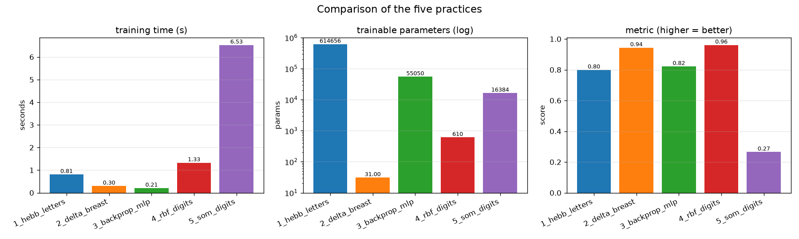

### Диаграмма рассеяния

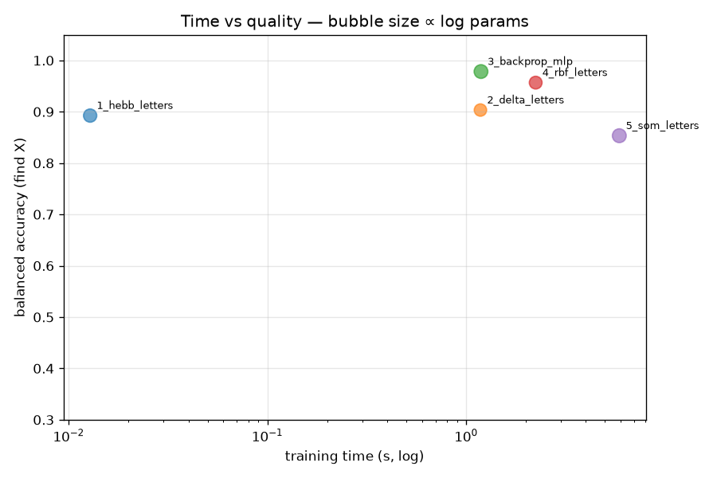

Размер пузыря ∝ log параметров.

### Что видно

- **Правый верхний угол — идеал** (быстро и хорошо). Там `3_backprop_mlp` и
  `4_rbf_letters`.
- **RBF — лучший компромисс**: 3 146 параметров (в 38 раз меньше MLP) при
  AUC 1.000.
- **SOM выпадает по качеству** — но это в первую очередь потому, что у него
  другая природа: карта на 256 нейронов, чтобы покрыть 26 классов, и каждый
  нейрон «помечает» целый класс.
- Явной корреляции между временем и качеством нет.

### Что эти числа НЕ говорят

- **Время обучения нельзя сравнивать напрямую.** Хебб обучился за 15 мс, потому
  что просто усреднял картинки; MLP делал 25 эпох градиентного спуска по 120 000
  параметров. Это разный объём работы.
- **Число параметров — тоже не единая метрика.** 200 704 у SOM — это 256 нейронов
  × 784 входа, и карта должна быть достаточно большой. 785 у дельты — это один
  нейрон, который работает, потому что «X» почти линейно отделяется.
- 26-классовая точность у дельты — прочерк: один нейрон не может назвать все 26
  букв, у него только бинарный вопрос «X или нет».

---

## 12. Главные выводы

1. **Принцип обучения — это выбор «как крутить веса», а не «как строить сеть».** Все пять практик — варианты одного и того же цикла: пример → ошибка → подкрутка.
2. **Один датасет и одна задача превращают набор лабораторных в честное сравнение.** Раньше у каждой практики был свой датасет и своя метрика, и таблица «кто круче» была бессмысленной. Теперь — нет.
3. **Учитель — не обязательное условие.** Хебб и SOM работают без меток; но оценить их качество без меток невозможно, поэтому это не «лучше».
4. **Чем проще архитектура, тем меньше параметров нужно.** RBF с 3 146 параметрами обошёл MLP с 120 000.
5. **Скорость обучения определяется не числом нейронов, а числом проходов.** RBF: K-means один раз + `lstsq` один раз. Backprop: каждый вес обновляется каждый шаг.
6. **Переобучение — главный враг**, и бороться с ним можно двумя путями: dropout (заставить сеть не полагаться на отдельные нейроны) и аугментация (заставить сеть не полагаться на конкретные пиксели). Вместе они работают лучше.
7. **XOR — это не провал, а фундаментальное ограничение.** Один нейрон = одна граница. Всё глубокое обучение — это способы обойти это ограничение.
8. **Нормализация на чтении вместо штрафа в правиле.** Правило Ойи не нужно: можно оставить обучение чистым, а нормировку сделать частью принятия решения.
9. **Метрика должна соответствовать задаче.** На задаче с 4% положительного класса обычная accuracy врёт — сеть «всегда не X» набирает 96%.

---

## 13. Глоссарий для тех, кто новичок

| термин | что значит простыми словами |
|---|---|
| **вес** | число, которое сеть «подкручивает» при обучении |
| **bias** | дополнительное свободное число, сдвигающее выход |
| **активация** | функция после суммы (sigmoid, ReLU, tanh) |
| **loss / ошибка** | насколько сеть не права |
| **эпоха** | один полный проход по всем обучающим примерам |
| **learning rate (η)** | насколько сильно каждый шаг меняет веса |
| **градиент** | направление, в котором ошибка уменьшается быстрее всего |
| **backprop** | распространение ошибки с выхода назад по слоям |
| **переобучение** | train хорош, test плохо — сеть выучила примеры, а не закон |
| **dropout** | случайно отключить часть нейронов при обучении |
| **аугментация** | искусственно менять данные (сдвиг, поворот) |
| **K-means** | разбить точки на K кластеров, минимизируя расстояния внутри |
| **U-матрица** | тепловая карта расстояний между соседями по карте SOM |
| **BMU** | нейрон-победитель, ближайший к входному вектору |
| **кросс-энтропия** | стандартная функция потерь для многоклассовой классификации |
| **balanced accuracy** | среднее из recall и specificity — честная метрика при дисбалансе классов |
| **ROC-AUC** | насколько хорошо сеть ранжирует картинки по вероятности «это X» |

---

## 14. Что можно улучшить дальше

Идеи, которые репозиторий оставляет открытыми:

- **Добавить настоящие рукописные буквы** (EMNIST) — сейчас буквы нарисованы
  системными шрифтами, и главная сложность задачи в том, что сеть видит новый
  шрифт. С рукописными буквами проверка обобщения станет настоящей.
- **Сделать X нетривиальным.** Сейчас X — крест из двух диагоналей, а V, W и Y
  рядом не стоят. Можно взять пару похожих букв (например, O и Q) — и задача
  сразу станет интереснее.
- **Проверить предел Рэя:** он предсказывает ошибку, зависящую от скорости
  обучения — можно построить и проверить график.
- **RBF на свёртках:** добавить признаковый слой и сравнить с CNN.
- **SOM на лицах** (например, Olivetti или LFW) — классика из оригинальных работ
  Кохонена.
- **Воспроизводимость:** зафиксировать seed и добавить в CSV номер запуска.

---

## Лицензия и происхождение

Код написан с нуля для учебных целей. Датасет: буквы A–Z, отрисованные через PIL
системными шрифтами Carlito (Apache 2.0), Liberation (SIL OFL) и FreeSans
(GPL + font exception). Каждая практика сопровождается README с формулами,
экспериментами и выводами.

Безопасность работы с системой описана в `~/.hermes/AGENT_RULES.md`.
