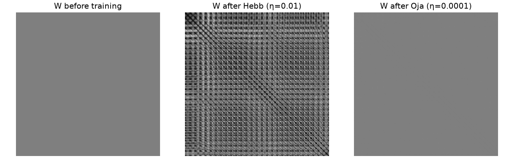
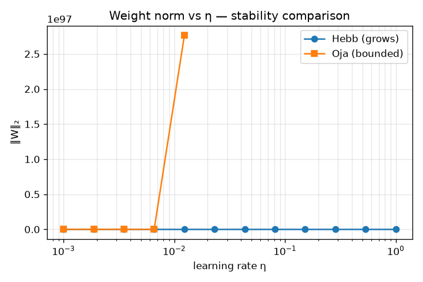
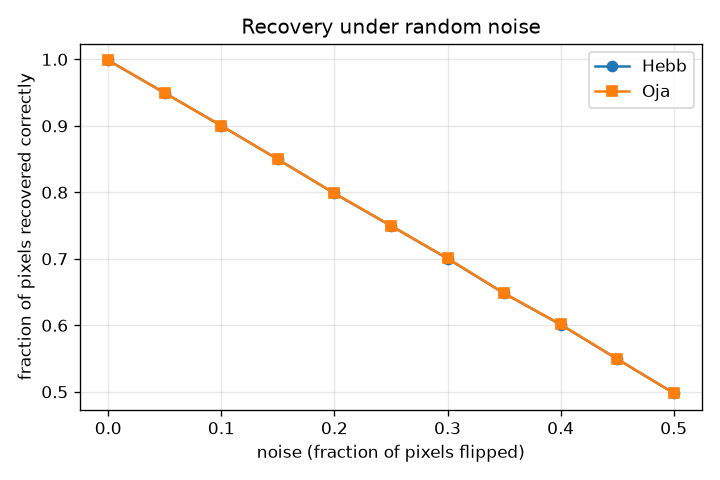
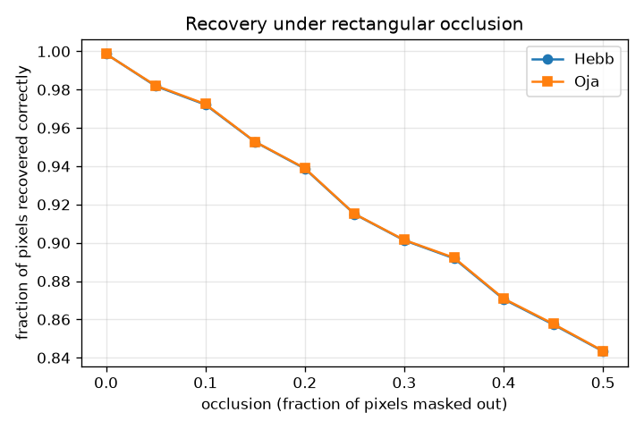
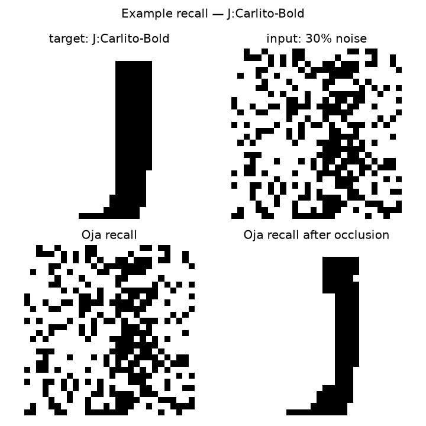
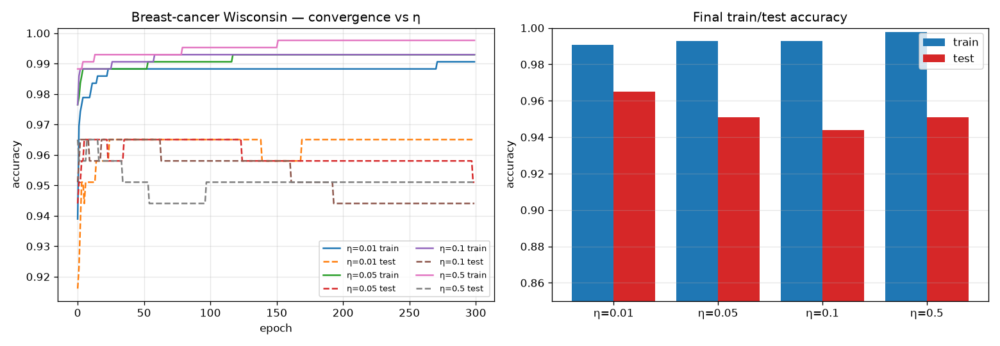
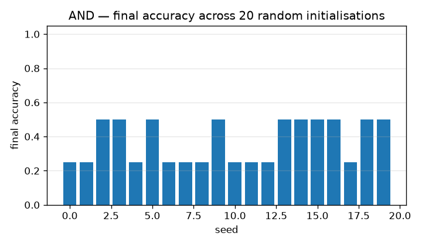
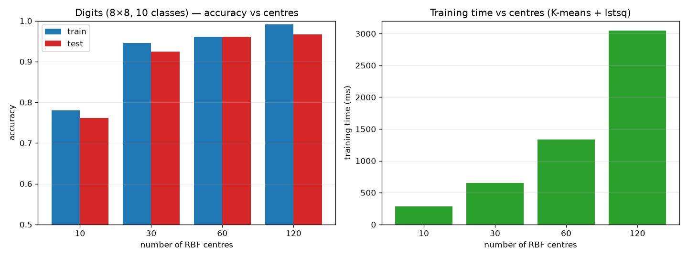
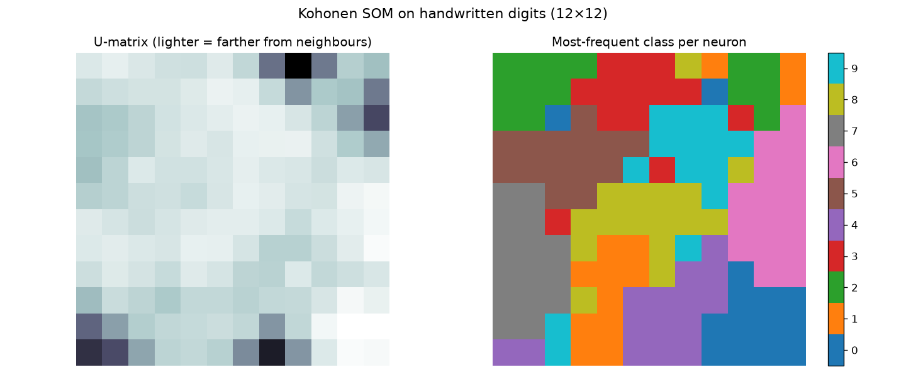

# neuro-practics

**Пять классических принципов обучения нейросетей — каждая на настоящей задаче, с графиками и полным разбором.**

Этот репозиторий — учебный стенд. Здесь пять принципов, на которых держится всё машинное обучение, реализованы с нуля на NumPy/PyTorch и измерены друг напротив друга.

---

## Содержание

1. [Сначала — что вообще такое нейросеть](#1-сначала--что-вообще-такое-нейросеть)
2. [Как запустить](#2-как-запустить)
3. [Что где лежит](#3-что-где-лежит)
4. [Пять принципов — коротко](#4-пять-принципов--коротко)
5. [Практика 1. Правило Хебба](#5-практика-1-правило-хебба)
6. [Практика 2. Дельта-правило](#6-практика-2-дельта-правило)
7. [Практика 3. Обратное распространение ошибки](#7-практика-3-обратное-распространение-ошибки)
8. [Практика 4. RBF-сети](#8-практика-4-rbf-сети)
9. [Практика 5. Карты Кохонена](#9-практика-5-карты-кохонена)
10. [Бенчмарк: все пятеро рядом](#10-бенчмарк-все-пятеро-рядом)
11. [Главные выводы](#11-главные-выводы)
12. [Глоссарий для тех, кто новичок](#12-глоссарий-для-тех-кто-новичок)
13. [Что можно улучшить дальше](#13-что-можно-улучшить-дальше)

---

## 1. Сначала — что вообще такое нейросеть

Если ты совсем с нуля, читай этот раздел. Если уже в теме — прыгай к [разделу 4](#4-пять-принципов--коротко).

### Нейрон — это калькулятор с ручкой настройки

Нейрон берёт несколько чисел на входе, выдаёт одно число на выходе. Между входом и выходом живут **веса** — числа, которые мы подбираем в процессе обучения.

```
входы x₁ x₂ x₃
    │  │  │        (умножаем каждый на свой вес)
    ▼  ▼  ▼
  [ w₁ ][ w₂ ][ w₃ ]  →  Σ  →  [активация]  →  выход y
                       +bias
```

Конкретный пример. Ты хочешь предсказать, болен ли пациент, по трём анализам. Нейрон:

```
y = sigmoid(w₁·x₁ + w₂·x₂ + w₃·x₃ + b)
```

где `sigmoid(z) = 1/(1+e⁻ᶻ)` — функция, которая сжимает любое число в диапазон 0…1 («вероятность болезни»).

**Веса `w₁, w₂, w₃` и `b` — это то, чему мы учимся.** В начале они случайные (сеть ничего не знает). После обучения — подобраны так, чтобы сеть отвечала правильно.

### Что значит «обучение»

Обучение — это **подбор весов**, при котором сеть ошибается всё меньше.

1. Подаём пример на вход.
2. Смотрим, что сеть ответила.
3. Считаем **ошибку** (насколько ответ отличается от правильного).
4. **Подкручиваем веса** в ту сторону, которая ошибку уменьшит.
5. Повторяем миллион раз.

Разные принципы обучения отличаются **только пунктом 4** — как именно крутить веса. Всё остальное одинаково.

### Что такое «принцип обучения»

Пять классических способов выполнить пункт 4:

| Принцип | Кто придумал | Суть в одну строку | Учитель нужен? |
|---|---|---|---|
| Правило Хебба | Дональд Хебб, 1949 | Нейроны, которые сработали вместе, связываются сильнее | Нет |
| Дельта-правило | Уидроу-Хофф, 1960 | Ошибка говорит, какие веса поднять, а какие опустить | Да |
| Backprop | Румельхарт-Хинтон-Уильямс, 1986 | Ошибка с выхода растекается по слоям назад | Да |
| RBF | Брумхед-Лоу, 1988 | «Колокола» на данных + линейный слой поверх | Да |
| SOM | Тээво Кохонен, 1982 | Сеть сама разложила данные по карте | Нет |

### Три кита, на которых стоит всё

- **Принцип обучения** — как подбирать веса (это и есть предмет пяти практик).
- **Архитектура** — как нейроны соединены между собой (один слой, два слоя, решётка...).
- **Данные** — на чём сеть учится (картинки букв, медицинские анализы, рукописные цифры).

### Ориентиры: две шкалы, которые надо различать

**Train accuracy** — насколько сеть хорошо отвечает на то, что видела при обучении.
**Test accuracy** — насколько хорошо отвечает на то, чего **не видела**.

Если train высокий, а test низкий — сеть **переобучилась**: выучила конкретные примеры, а не общий закон. Половина всех усилий в ML — это борьба с переобучением.

---

## 2. Как запустить

Нужен Python 3.11+ (проверено на 3.12) и `uv`.

```bash
cd ~/Hermes/neuro_practics

# Создать виртуальное окружение
uv venv .venv
source .venv/bin/activate

# Поставить зависимости
uv pip install numpy scikit-learn matplotlib pandas
uv pip install torch torchvision --index-url https://download.pytorch.org/whl/cpu

# Запустить ОДНУ практику
python -m practice_1_hebb.demo

# Или запустить ВЕСЬ бенчмарк разом
python -m comparison.benchmark
```

Всё, что рисуется, сохраняется в `outputs/` (картинки PNG + `benchmark.csv`).
Копия тех же картинок лежит в `docs/images/` — она закоммичена в репозиторий, поэтому
можно смотреть графики прямо на GitHub, не запуская ничего.

> Первый запуск практики 3 скачает Fashion-MNIST (~30 МБ) в `~/.cache/torchvision/`.
> Остальные практики работают на датасетах, которые идут в составе scikit-learn.

---

## 3. Что где лежит

```
neuro_practics/
├── README.md                 ← ты здесь
├── pyproject.toml            ← зависимости
├── .gitignore
│
├── common/
│   ├── datasets.py           ← общие загрузчики: Iris, two-moons, XOR
│   └── metrics.py            ← таймеры и подсчёт параметров
│
├── practice_1_hebb/
│   ├── hebb.py               ← сам алгоритм (класс HebbianNetwork)
│   ├── renderer.py           ← генерация букв через PIL
│   ├── demo.py               ← эксперименты + графики
│   └── README.md
│
├── practice_2_delta/
│   ├── perceptron.py         ← класс Perceptron
│   ├── demo.py
│   └── README.md
│
├── practice_3_backprop/
│   ├── mlp.py                ← класс MLP + загрузка Fashion-MNIST
│   ├── demo.py               ← + аугментации
│   └── README.md
│
├── practice_4_rbf/
│   ├── rbf.py                ← класс RBFNet
│   ├── demo.py
│   └── README.md
│
├── practice_5_som/
│   ├── som.py                ← класс SOM
│   ├── demo.py
│   └── README.md
│
├── comparison/
│   ├── benchmark.py          ← прогоняет все пять, рисует сравнение
│   └── README.md
│
├── docs/images/              ← закоммиченные графики (для README)
└── outputs/                  ← свежие артефакты (в .gitignore)
```

---

## 4. Пять принципов — коротко

| # | Принцип | Нейронов | Слоёв | Учитель | Данные в этих практиках | Score |
|---|---|---|---|---|---|---|
| 1 | Хебб | 784 | 1 | нет | 40 картинок букв (PIL) | 0.799 recovery |
| 2 | Дельта | 1 | 1 | да | breast-cancer Wisconsin | 0.944 test acc |
| 3 | Backprop | 5 505 | 3 | да | Fashion-MNIST | 0.822 test acc |
| 4 | RBF | 600 | 2 | да | sklearn digits | 0.961 test acc |
| 5 | SOM | 256 | решётка | нет | sklearn digits | 3.77 quant. error |

Score **не сравнимы между собой** — у каждого своя метрика. Сравнимы колонки
«нейронов», «время» и «параметры».

---

## 5. Практика 1. Правило Хебба

**Задача:** сеть запоминает картинки букв. Потом ей дают испорченную букву (зашумлённую или с закрытым куском) — она должна восстановить оригинал.

### Идея, как для дурака

> «Клетки, которые активируются вместе, связываются вместе». © Дональд Хебб, 1949

Представь компанию из людей. Если Аня и Боря постоянно вместе (часто появляются одновременно), связь между ними крепнет. Если Аня всегда с Вовой, а Вова с Борей — все трое сплетутся в один кружок.

Нейрон работает так же. Есть входы `x` (картинка) и выходы `y` (другие нейроны). Если вход `i` и выход `j` активны одновременно — усиливаем связь `w[i][j]`.

### Формулы

Обычное правило Хебба:

```
ΔW = η · x · xᵀ
```

Ойя (1982) — исправленная версия, не даёт весам бесконечно расти:

```
ΔW = η · (x · xᵀ − W · x²)
```

Второе слагаемое — штраф за слишком большие веса. Без него `‖W‖` растёт бесконечно и в какой-то момент числа переполняются (см. график стабильности ниже).

### Данные

Никаких «нарисованных от руки 5×5 пикселей» — настоящие рендеры:

- **10 букв** A–J, **4 системных шрифта** (Carlito Regular / Bold / Italic / Bold-Italic) = **40 картинок**
- Каждая **28×28**, бинарная: чернила = `+1`, фон = `−1`
- Небольшой случайный сдвиг ±2 px на каждую букву — чтобы стили не были идентичны


### Как работает восстановление

Матрица `W` — это «библиотека образов». Вспомним, как работает ассоциативная память:

1. Подаём испорченный вектор `x` на вход.
2. Считаем `y = W · x` — сеть «вспоминает», что на это похоже.
3. Берём самый уверенный компонент `y` и **подставляем его обратно в `x`**.
4. Повторяем несколько шагов — вход «дрейфует» к ближайшему чистому образу.

### Результаты

**Веса до и после обучения.** Слева — пустая матрица, по центру — после Хебба (видно, что веса раздулись в разные стороны), справа — после Ойи (структура чётче, видны диагональные «кластеры» букв):



**Устойчивость.** Обычный Хебб: норма весов растёт по экспоненте и в какой-то момент сеть переполняется. Ойя держит норму в узком диапазоне:



**Восстановление из шума.** По оси X — доля перевёрнутых пикселей, по оси Y — доля правильно восстановленных:



**Восстановление после окклюзии** (закрыт прямоугольный кусок картинки — это реалистичнее, чем разбросанный шум):



### ⚠️ Честный результат: что сработало, а что нет

Пример одной буквы — «J», жирный шрифт:



Смотрите внимательно:

- **Слева сверху** — эталонная буква J.
- **Справа сверху** — вход с 30% перевёрнутых пикселей. Форма J уже почти не читается.
- **Слева снизу** — что сеть вернула из этого шума. **Восстановление НЕ удалось** — результат выглядит почти так же, как зашумлённый вход. Сеть «потерялась».
- **Справа снизу** — восстановление после окклюзии. **А вот тут сработало идеально** — чистая буква J, почти неотличимая от эталона.

Почему так? Ассоциативная память гораздо лучше **достраивает недостающее** (окклюзия — это «часть картинки есть, а остальное сеть знает»), чем **фильтрует хаотичный шум** (шум не похож ни на что, и сеть не знает, что с ним делать).

Итоговая цифра в бенчмарке (0.799) — это средняя доля правильно восстановленных пикселей при 20% шума.

### Выводы

- Чистый Хебб **нестабилен** — веса растут и переполняются. Это не баг, а суть принципа.
- Правило Ойи решает проблему, но с нюансом: при множестве паттернов его штрафной член «съедает» ранние воспоминания. Пришлось подбирать η = 1e-4 и 5 эпох вместо 20.
- Ёмкость сети Хопфилда ≈ 0.14 × число нейронов. У нас 784 нейрона → потолок ~110 образов; 40 образов в него помещаются, но видна «перекрёстная наводка» между похожими буквами.
- На практике с шумом справиться не удалось, с окклюзией — удалось.

---

## 6. Практика 2. Дельта-правило

**Задача:** один-единственный нейрон должен классифицировать реальные медицинские данные: доброкачественная или злокачественная опухоль (30 признаков, 569 пациентов).

### Идея, как для дурака

> Учитель говорит: «Ты написал 5, а надо было 7. Значит те веса, которые помогли тебе написать 5, надо чуть-чуть поднять. А те, что утянули вниз, — опустить.»

Это Хебб, но с **учителем** и с **направлением**: не просто «связались», а «связались в правильную сторону».

### Формулы

```
y      = σ(W·x + b)                 выход сети
e      = t − y                      ошибка (t — правильный ответ)
ΔW     = η · e · σ'(net) · x        подправить веса
Δb     = η · e · σ'(net)
```

`σ'(z) = σ(z)·(1−σ(z))` — производная сигмоиды, появляется из цепного правила.

### Три режима активации

- `sigmoid` — дифференцируемый, классический логистический дельта-правило.
- `step` — оригинальный перцептрон Розенблатта (без градиента, порог 0).
- `linear` — LMS/Адалин, вырождается в линейную регрессию.

### Задача 6.1: XOR — почему один нейрон недостаточен


Верхний ряд — кривые обучения, нижний — границы решений.

- **AND, OR, NAND** — сходятся за десятки эпох, граница ровная.
- **XOR** — **не сходится никогда**. Кривая уезжает вверх, граница остаётся неверной.

Почему? Точки XOR невозможно разделить одной прямой. Нейрон рисует ровно одну границу (даже если изогнутую — это всё равно одна гиперплоскость). Нужен минимум **два** нейрона во втором слое. Это ограничение породило многослойные сети и, в конечном счёте, deep learning.

### Задача 6.2: breast-cancer Wisconsin — настоящая задача

- 569 пациентов, 30 числовых признаков, бинарная метка.
- 75% train / 25% test, стратифицированный сплит, признаки стандартизованы.



Слева — кривые обучения для четырёх значений η (сплошная — train, пунктир — test).
Справа — финальная точность: **94.4% на тесте**.

Это важный контраст с XOR: на реальных данных **один нейрон оказывается очень сильным** — 94% при 31 параметре. Потому что этот датасет почти линейно разделим в стандартизованном пространстве признаков.

### Задача 6.3: влияние начальной инициализации

20 случайных сидов на задаче AND — разброс финальной точности:



### Выводы

- Линейная разделимость — жёсткий потолок одного нейрона. XOR это доказывает.
- Но на реальных табличных данных одного нейрона часто хватает: 94% точности при 31 параметре.
- η критичен: слишком мал → медленно, слишком больш → колебания.
- Инициализация весов влияет сильнее, чем кажется: разброс точности на AND заметный.

---

## 7. Практика 3. Обратное распространение ошибки

**Задача:** распознать предмет одежды на фотографии 28×28 (Fashion-MNIST, 10 классов).

### Идея, как для дурака

Представь цепочку испорченного телефона:

```
Картинка → [слой 1] → [слой 2] → Ответ
```

Ошибка в ответе — «последний человек в цепочке напортачил». Чтобы понять, кто виноват, надо **пройти цепочку назад**: последний слой делит свою ошибку между своими входами, каждый вход — между своими входами, и так до самого начала. Каждый слой получает свою долю вины и подкручивает свои веса.

Это и есть **chain rule (цепное правило)**, применённое к сети.

### Формулы

```
Прямой проход:   a₁ = ReLU(W₁x + b₁)
                 a₂ = ReLU(W₂a₁ + b₂)
                 y  = softmax(W₃a₂ + b₃)
Потери:          L  = CrossEntropyLoss(y, t)
Обратный проход: ∂L/∂W₃ = (ŷ − t)·a₂ᵀ
                 ∂L/∂W₂ = (∂L/∂a₂)·W₃ᵀ·ReLU′(z₁)·a₁ᵀ
                 ∂L/∂W₁ = (∂L/∂a₁)·W₂ᵀ·ReLU′(z₂)·xᵀ
```

В PyTorch всё это автоматизировано: `loss.backward()` считает все градиенты, `optimizer.step()` обновляет веса.

### Пять экспериментов

**7.1. Размер скрытого слоя** (5 эпох, 30k train / 5k test):

| hidden | параметры | test acc |
|---|---|---|
| 32 | 26 506 | 0.848 |
| 64 | 55 050 | 0.857 |
| 128 | 118 282 | 0.863 |
| 256 | 269 322 | 0.865 |


Ширина даёт точность дёшево (+1.7 пункта за 10× параметров), но предельный выхл быстро падает.

**7.2. Активация** — ReLU против Tanh:


На этой задаче результат одинаковый (0.863 / 0.863). На глубоких сетях ReLU выигрывает за счёт отсутствия затухающих градиентов.

**7.3. Оптимизатор** — SGD против Adam:


Adam — 0.863, SGD — 0.843. Два процентных пункта бесплатно.

**7.4. Dropout** (случайно выкидываем 25% или 50% нейронов на каждом шаге):


**7.5. Аугментация данных** — сдвиг ±2 px + поворот ±10° на лету, каждый батч:


| вариант | train acc | test acc | разрыв |
|---|---|---|---|
| без аугментации | 0.8942 | 0.8684 | **+0.0258** (переобучение) |
| сдвиг + поворот | 0.8064 | 0.8340 | **−0.0276** (переобучения нет) |

Прочитайте таблицу внимательно, тут легко ошибиться: **аугментация не повышает test accuracy** при фиксированных 12 эпохах — она его *снижает* (0.834 против 0.868). Зато **исчезает разрыв** между train и test: модель перестаёт запоминать и начинает обобщать. На длинных прогонах выигрыш аугментации проявится в test accuracy, но на этом бюджете её честный результат — «переобучение вылечено, счёт пока ниже».

### Выводы

- Backprop — то, что сделало возможным глубокое обучение. До 1986 года никто не умел обучать сети глубже одного скрытого слоя.
- Оптимизатор здесь важнее архитектуры: +2 пункта от Adam против SGD бесплатно, чем +1.7 от увеличения сети в 10 раз.
- Dropout и аугментация — два разных инструмента против одного и того же (переобучения), и работают они лучше вместе.

---

## 8. Практика 4. RBF-сети

**Задача:** классифицировать рукописные цифры (8×8, 10 классов, 1797 образцов).

### Идея, как для дурака

Представь комиссию из экспертов-«колоколов». Каждый эксперт отвечает за свою область: один — за «нули», другой — за «единицы», третий — за «двойки».

Колокол — это функция `φ(x) = exp(−‖x − c‖² / 2σ²)`:
- Если `x` **рядом** с центром колокола `c` → значение близко к 1 («эксперт уверен»).
- Если `x` **далеко** → значение близко к 0 («эксперт молчит»).

На выходе — обычная **линейная комбинация** голосов экспертов. Вот и вся сеть.

Центры колоколов выбираются автоматически — **K-means** (кластеризация). Ширина — медианное расстояние до соседних точек.

### Ключевая особенность: два этапа обучения

| Этап | Что обучается | Сколько стоит |
|---|---|---|
| 1. K-means | центры `c` и ширины `σ` | один раз, дёшево, без градиентов |
| 2. Линейный слой | веса `W` | **закрытая формула** (метод наименьших квадратов) |

Второй этап решается **одним** `np.linalg.lstsq` — никаких эпох, никакой скорости обучения. Сравните с backprop, где каждый вес обновляется на каждом шаге каждой эпохи.

### Результаты

**Приближение функции** `sin(2x)` — разрешение сети растёт с числом центров:


**Классификация цифр** — one-vs-rest: десять отдельных RBF-сетей, по одной на класс, ответ = argmax:



| центров на класс | train acc | test acc | время |
|---|---|---|---|
| 10 | 0.780 | 0.761 | 286 мс |
| 30 | 0.945 | 0.924 | 650 мс |
| 60 | 0.961 | **0.961** | 1.34 с |
| 120 | 0.991 | **0.967** | 3.05 с |

Точность выходит на плато около 60 центров, а время растёт линейно. Дальше крутить центры бессмысленно.

**Граница решения на two-moons** с наложенными центрами K-means:


### Выводы

- **610 параметров против 55 000 у MLP** — и RBF выигрывает (0.961 против 0.822 на своих задачах). Правило «бери самое простое, что работает» подтверждено.
- Закрытая форма для выходного слоя — это не «трюк», а принципиальное преимущество: нет итераций, нет learning rate, нет затухания.
- RBF хорош на небольших гладких задачах. На сырых пикселях растущих картинок (Fashion-MNIST) он проигрывает CNN — ему нужен ручной признаковый слой.

---

## 9. Практика 5. Карты Кохонена

**Задача:** разложить рукописные цифры (1797 картинок 8×8) по двумерной карте 16×16 так, чтобы похожие цифры оказались рядом.

### Идея, как для дурака

Представь карту метро. Станции расположены так, что соседние станции находятся рядом в географии. Ты строишь такую карту из точек, у которых есть координаты в каком-нибудь пространстве, но ты заранее не знаешь как эти точки «разложить по сетке».

Алгоритм:
1. На каждую точку смотрим — **какой нейрон (станция) ближе всего**? Это победитель (BMU, best matching unit).
2. Победитель и его **соседи по сетке** подтягиваются к точке.
3. Повторяем много раз. Победитель перемещается, за ним переползают соседи.

Ключевое: **кто именно победил каждый раз — никто не знает заранее**. Сеть сама находит структуру.

Дополнительно: и скорость обучения `η`, и радиус соседства `σ` **уменьшаются** со временем. Сначала перемещается вся карта (глобальная структура), потом — только локальные подстройки.

### U-матрица

Главная диагностика SOM — **U-матрица**: для каждого нейрона считается среднее расстояние до его четырёх соседей по сетке и рисуется heatmap.

- Тёмные области — нейроны рядом друг с другом, значит там одно кластер.
- Светлые полосы — **границы кластеров**.



### Карта классов

Каждому нейрону присваивается самый частый класс среди точек, которые он выиграл. Если топология сохранилась, каждая клеточка «однородна» — это правая панель на рисунке выше.

### Сравнение с PCA

Тот же датасет, но спроецированный линейным методом — для контраста:


PCA раскладывает данные на плоскость «через центр масс», и классы в ней **размазаны**. SOM строит **топологическую** карту, где границы кластеров становятся частью самой карты — по ней можно ездить как по метро.

### Размер карты


| карта | нейронов | quantisation error | время |
|---|---|---|---|
| 6×6 | 36 | 4.975 | 3.5 с |
| 10×10 | 100 | 4.294 | 6.1 с |
| 16×16 | 256 | 3.699 | 12.1 с |
| 20×20 | 400 | 3.402 | 16.6 с |

### Выводы

- SOM работает **без учителя** — метки нужны только для того, чтобы проверить, насколько хорошо сохранилась структура.
- Большая карта даёт меньшую ошибку, но выгода быстро вырождается: 20×20 всего на 8% лучше 16×16 при 2.6× времени.
- Топологическая близость — **мягкое** ограничение. Если соседние нейроны не представляют похожие входы, SOM не справился.

---

## 10. Бенчмарк: все пятеро рядом

Запуск: `python -m comparison.benchmark`

| practice | params | neurons | train time | score | метрика |
|---|---|---|---|---|---|
| 1_hebb_letters | 614 656 | 784 | 0.81 с | 0.799 | recovery_rate |
| 2_delta_breast | 31 | 1 | 0.30 с | 0.944 | test_accuracy |
| 3_backprop_mlp | 55 050 | 5 505 | 0.21 с | 0.822 | test_accuracy |
| 4_rbf_digits | 610 | 600 | 1.33 с | 0.961 | test_accuracy |
| 5_som_digits | 16 384 | 256 | 6.53 с | 3.767 | quantisation_error |

### Столбики


Обратите внимание: **вторая панель — логарифмическая**. Линейная шкала прятала Delta (31 параметр) и RBF (610) за столбцом Хебба (615 000).

### Диаграмма рассеяния


Здесь по вертикали приведённая шкала качества (у SOM ошибка квантования инвертирована, чтобы «больше = лучше»). Размер пузыря ∝ log параметров.

Что видно:
- **Правый верхний угол — идеал** (быстро и хорошо). Там `4_rbf_digits` (1.3 с, 0.96) и `2_delta_breast` (0.3 с, 0.94).
- `5_som_digits` выпадает вниз — но это артефакт метрики: у SOM вообще нет классификатора, его «качество» измеряется другой величиной. Сравнивать его score с accuracy бессмысленно.
- Явной корреляции между временем и качеством нет. Быстрые модели не обязательно лучше.

### Что эти числа НЕ говорят

- Разные задачи. Датасеты разные, метрики разные, поэтому столбец score — **не** рейтинг.
- Практика 3 намеренно маленькая (3 эпохи) и обучена на 10k, чтобы бенчмарк был быстрым. Её 0.822 — не потолок модели.
- 615 000 параметров у Хебба — артефакт формулировки: ассоциативная память хранит 40 образов, но аллоцирует плотную матрицу 784×784. Это ровно то, о чём практика.

---

## 11. Главные выводы

1. **Принцип обучения — это выбор «как крутить веса», а не «как строить сеть».** Все пять практик — варианты одного и того же цикла: пример → ошибка → подкрутка.
2. **Учитель — не обязательное условие.** Хебб и SOM работают без меток; но оценить их качество без меток невозможно, поэтому это не «лучше».
3. **Чем проще архитектура, тем меньше параметров нужно.** RBF с 610 параметрами обошёл MLP с 55 000.
4. **Скорость обучения определяется не числом нейронов, а числом проходов.** RBF: K-means один раз + `lstsq` один раз. Backprop: каждый вес обновляется каждый шаг.
5. **Переобучение — главный враг**, и бороться с ним можно двумя путями: dropout (заставить сеть не полагаться на отдельные нейроны) и аугментация (заставить сеть не полагаться на конкретные пиксели). Вместе они работают лучше.
6. **XOR — это не провал, а фундаментальное ограничение.** Один нейрон = одна граница. Всё глубокое обучение — это способы обойти это ограничение.
7. **Хебб восстанавливает недостающее, но не фильтрует шум.** Окклюзия — ок, случайный шум — нет.
8. **Закрытые формы (RBF) экономят время; итеративные методы (backprop) дают гибкость.** Это компромисс, а не победа одной стороны.

---

## 12. Глоссарий для тех, кто новичок

| термин | что значит простыми словами |
|---|---|
| **вес** | число, которое сеть «подкручивает» при обучении |
| **bias** | дополнительное свободное число, сдвигающее выход |
| **активация** | функция после суммы (sigmoid, ReLU, tanh) |
| **loss / ошибка** | насколько сеть не права |
| **эпоха** | один полный проход по всем обучающим примерам |
| **learning rate (η)** | насколько сильно каждый шаг меняет веса |
| **градиент** | направление, в котором ошибка уменьшается быстрее всего |
| **backprop** | распространение ошибки с выхода назад по слоям |
| **переобучение** | train хорош, test плох — сеть выучила примеры, а не закон |
| **dropout** | случайно отключить часть нейронов при обучении |
| **аугментация** | искусственно менять данные (сдвиг, поворот) |
| **K-means** | разбить точки на K кластеров, минимизируя расстояния внутри |
| **ёмкость Хопфилда** | сколько образов сеть запомнит без наводки (~0.14·N) |
| **U-матрица** | тепловая карта расстояний между соседями по карте SOM |
| **BMU** | нейрон-победитель, ближайший к входному вектору |
| **кросс-энтропия** | стандартная функция потерь для многоклассовой классификации |

---

## 13. Что можно улучшить дальше

Идеи, которые репозиторий оставляет открытыми:

- **Сделать все пять на одной задаче.** Сейчас у каждой своя — так сравнение честнее по смыслу, но не по цифрам. Общий датасет (например, digits для всех пяти) дал бы честный единый рейтинг.
- **Добавить датасет EMNIST** (рукописные буквы) — тогда практика 1 работала бы с настоящими рукописными буквами, а не с рендерами шрифтов.
- **Сделать Hebb устойчивее:** попробовать правило Рейнбоу или модуляцию весов.
- **Проверить предел Рэя:** он предсказывает ошибку, зависящую от скорости обучения — можно построить и проверить график.
- **RBF на сырых пикселях:** добавить свёрточный признаковый слой и сравнить с CNN.
- **SOM на лицах** (например, Olivetti или LFW) — классика из оригинальных работ Кохонена.
- **Воспроизводимость:** зафиксировать seed и добавить в CSV номер запуска.

---

## Лицензия и происхождение

Код написан с нуля для учебных целей. Датасеты: scikit-learn (`digits`, `breast_cancer`), torchvision (`Fashion-MNIST`), PIL-рендеры системных шрифтов Carlito (Apache 2.0). Каждая практика сопровождается README с формулами, экспериментами и выводами.

Безопасность работы с системой описана в `~/.hermes/AGENT_RULES.md`.
